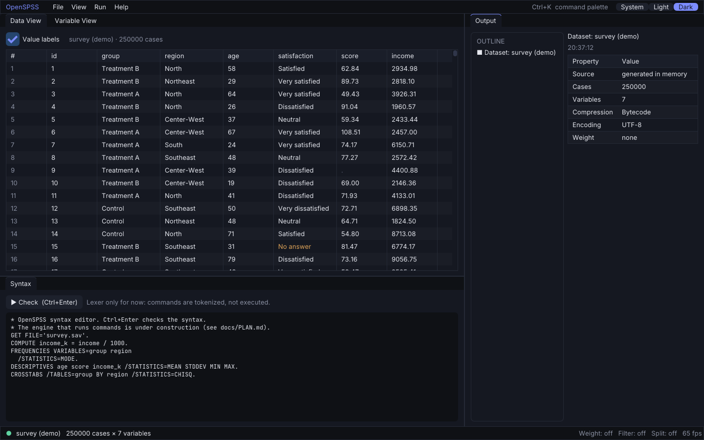
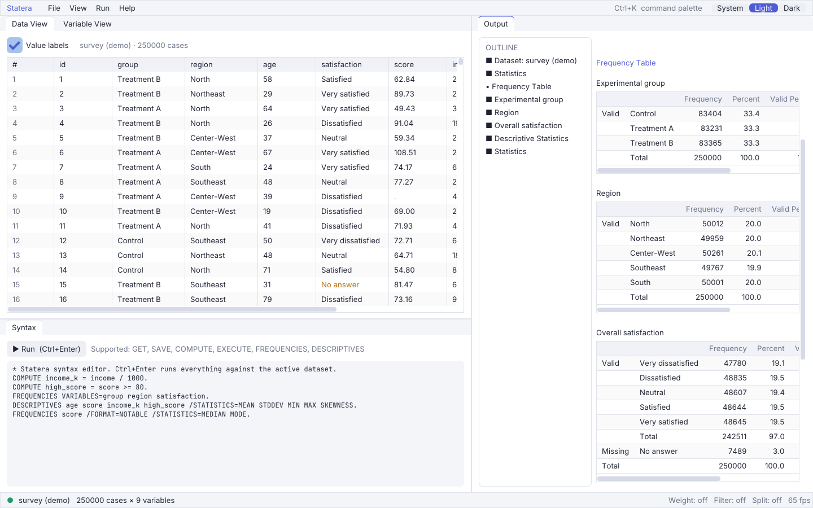

# Statera

*Latin for "balance, scales": an open-source, SPSS-compatible statistics package.*

Statera aims to **behave exactly like IBM SPSS Statistics**: same syntax, same file formats, same numbers. It's written from scratch in [Odin](https://odin-lang.org) for speed and uses a modern [Dear ImGui](https://github.com/ocornut/imgui) interface in place of the legacy Swing look.

> **Status:** pre-alpha. `.sav` read/write; `GET`, `SAVE`, `COMPUTE`, `SELECT IF`, `FILTER`, `WEIGHT`, `SORT CASES`, `SPLIT FILE` and `TEMPORARY`; and `FREQUENCIES`, `DESCRIPTIVES`, `CROSSTABS`, `MEANS`, `T-TEST` and `ONEWAY` all work. Their output matches SPSS 25 cell for cell in the golden tests, weighted and split included.

> Statera is an independent project. It is not affiliated with, endorsed by, or sponsored by IBM. "IBM" and "SPSS" are trademarks of IBM Corp., used here only to describe compatibility.

---

## Why

SPSS is the default tool in many universities, hospitals and research labs. It's also expensive, closed and slow, and its UI dates from the early 2000s. Statera wants to be a drop-in replacement:

- **Run your existing `.sps` syntax unchanged** and get the same results.
- **Open and save `.sav`, `.zsav`, `.por` and `.spv`** files with full fidelity, including value labels, missing values, measurement levels and documents.
- **Produce the same numbers.** Every procedure is checked against reference output to a defined numeric tolerance.
- **Be fast.** A native Odin engine with columnar storage, SIMD where it helps, and multithreaded passes over the data.
- **Look good.** A GPU-rendered, themeable, docking UI with dark mode, a command palette, and live-updating output.
- **Be AI-native.** A built-in MCP server and local API so agents and scripts can drive the whole app (see [AI & MCP support](#ai--mcp-support)).

### What about GNU PSPP?

[PSPP](https://www.gnu.org/software/pspp/) is the existing free SPSS alternative, and its documentation of the system-file formats is an excellent public reference. Statera differs in three ways: it targets full procedure coverage with numerically matched output, a modern high-performance UI, and first-class automation and AI support. We read PSPP's *documentation*. We don't copy its GPL code, so Statera can choose its own license.

---

## Compatibility targets

| Area | Target |
|---|---|
| Command syntax | Every command from SPSS Statistics 25, parsed with the same rules (abbreviations, `.` terminators, `TO` ranges, subcommand order, error messages) |
| Transformations | `COMPUTE`, `RECODE`, `IF`, `DO IF`, `LOOP`, `VECTOR`, the function library, date/time arithmetic, `SYSMIS` propagation semantics |
| Data files | `.sav` (read/write, incl. compressed), `.zsav`, `.por`, CSV/TSV/fixed text, Excel |
| Output | Pivot tables with the same structure, labels and footnotes; export to `.spv`, HTML, CSV, XLSX, PDF; OMS-style XML |
| Procedures | Descriptive stats, crosstabs, means, t-tests, ANOVA/GLM, correlation, regression (linear, logistic, ordinal, multinomial), nonparametrics, factor/PCA, reliability, clustering, survival, mixed models, and more, prioritized by real-world usage |
| Numerics | Printed output identical to the reference at the displayed precision; unrounded values within a per-procedure tolerance (default 1e-10 relative) |

**Non-goals:** copying IBM's code, binaries, icons, help text or sample datasets, or cloning the legacy look. We match *behavior*, not *expression*.

---

## Architecture (planned)

```
src/
├── io/          # .sav / .zsav / .por / csv / xlsx readers & writers
├── data/        # dataset model: columnar variables, dictionary, labels, missing values, weights, splits
├── syntax/      # lexer, parser and command grammar; error reporting identical to SPSS
├── transform/   # expression VM: COMPUTE/RECODE/IF/LOOP, function library, date math
├── engine/      # command dispatch, data passes, SET/TEMPORARY semantics
├── procs/       # statistical procedures, one package per command family
├── numerics/    # linear algebra, distributions, special functions, optimizers
├── output/      # pivot-table model, footnotes, TableLooks, exporters
├── automation/  # MCP server, local HTTP/JSON API, CLI batch runner
└── app/         # Dear ImGui front-end: data view, variable view, syntax editor, output viewer
tests/golden/    # golden tests against reference output
```

- **Platforms:** Windows, Linux and macOS, all first-class. CI runs the gate on all three, and releases ship native installers for each (Windows setup `.exe`, macOS `.dmg`, Linux AppImage/`.deb`).

- **UI stack:** Dear ImGui (docking branch) via generated [dear_bindings](https://github.com/dearimgui/dear_bindings) for Odin, on SDL3 (`vendor:sdl3`) with the OpenGL 3 backend.
- **Engine and UI are decoupled.** The UI is just one client of the engine. The CLI, the MCP server and the API go through the same command interface, so anything the UI can do, an agent can do too.
- **Syntax is the source of truth.** As in SPSS, every dialog generates syntax, and the syntax is what runs. This gives you reproducibility for free.
- **Columnar, cache-friendly data.** Numeric variables are `[]f64` columns and strings are arena-backed, so procedures stream over contiguous memory.

---

## Modern UI

The legacy SPSS UI is functional but cramped. Statera keeps the familiar mental model (Data View, Variable View, Syntax, Output) and modernizes how it's presented:

- Docking workspace: arrange data, syntax and output side by side, and save layouts.
- Dark and light themes, accent colors, crisp scalable fonts, and full high-DPI support.
- Command palette (`Ctrl+K`) to run any procedure or open any dialog by name.
- A syntax editor with highlighting, autocomplete driven by the command grammar, inline error squiggles, and run-selection.
- Virtualized data grid that scrolls smoothly through millions of rows.
- Output viewer with collapsible pivot tables, drag-to-pivot, and charts rendered on the GPU.
- Every dialog shows the syntax it will run, live as you edit it.

---

## AI & MCP support

Statera ships an automation layer so LLM agents, notebooks and scripts can use it as a stats engine.

### MCP server

Run `statera mcp` (stdio) or enable it in the app (streamable HTTP on localhost). Planned tools:

| Tool | Description |
|---|---|
| `open_dataset` / `save_dataset` | Load or save `.sav`, `.csv` and similar files |
| `describe_dataset` | Dictionary: variables, types, labels, missing values, measurement levels |
| `get_cases` | Paged access to case data, with optional filters |
| `run_syntax` | Run SPSS syntax and get structured results (tables as JSON) plus warnings |
| `list_commands` / `explain_command` | Grammar-aware help for any command or subcommand |
| `validate_syntax` | Parse without running, returning errors with positions |
| `suggest_analysis` | Map a research question and variable types to candidate procedures and syntax |
| `get_output` / `export_output` | Fetch output items or export them to HTML, XLSX, PDF or `.spv` |

Resources expose the active dataset dictionary and the output document. Prompts include templates such as "check assumptions for this t-test" and "write an APA-style results paragraph".

### Local API

Running `statera serve` exposes the same operations as a JSON-over-HTTP API, for Python, R or JS clients. A thin Python client (`pip install statera`) is planned, so `import statera` covers the common `spss` module workflows.

### In-app assistant (optional, bring your own key)

- Plain-language input generates syntax. You always see the syntax and approve it before it runs.
- An "Explain this table" button on any output item.
- Works with any MCP-capable or OpenAI-compatible endpoint, including local models. It's off by default, and no data leaves the machine unless you configure a remote endpoint.

---

## Roadmap

1. **Foundations.** Repo rules, clean-room process, RE environment ([rea](https://github.com/morluto/rea) plus Ghidra), golden-test harness.
2. **Data I/O.** `.sav`/`.zsav`/`.por` read/write, the dictionary model, and round-trip tests.
3. **Syntax and transforms.** Lexer, parser, expression VM, and the data-management commands (`GET`, `SAVE`, `COMPUTE`, `RECODE`, `SELECT IF`, `SORT`, `AGGREGATE`, `MATCH FILES`).
4. **Output model.** Pivot tables, TableLooks, and exporters.
5. **First procedures.** `FREQUENCIES`, `DESCRIPTIVES`, `CROSSTABS`, `MEANS`, `T-TEST`, `ONEWAY`, `CORRELATIONS`, `REGRESSION`.
6. **UI MVP.** Data/Variable view, syntax editor, output viewer, and core dialogs.
7. **Automation.** CLI batch mode, MCP server, local API.
8. **Procedure breadth.** GLM, logistic, nonparametrics, factor, reliability, clustering, survival, mixed models, and more.

9. **First release.** GitHub Release with installers for Windows, macOS and Linux.

The detailed, living plan is in [`docs/PLAN.md`](docs/PLAN.md).

---

## Clean-room reverse engineering

Statera learns how SPSS *behaves* using [rea](https://github.com/morluto/rea), an MCP server for reverse engineering. It never ships or transliterates IBM code. The process is in [AGENTS.md](AGENTS.md#clean-room-reverse-engineering). In short:

1. **Analysts** observe behavior (black-box runs, file-format inspection, static analysis) and write **specs in their own words** in `docs/specs/`.
2. **Implementers** write Odin code from those specs, public literature, and IBM's published algorithm documentation.
3. **Golden tests** compare our output against reference output generated from our own datasets.

Reverse engineering for interoperability is lawful in many jurisdictions but restricted by some licenses. Contributors are responsible for complying with the license terms and laws that apply to them. This README isn't legal advice.

---

## Screenshots

| Dark | Light |
|---|---|
|  |  |

The theme follows your OS by default. Switch it with the System / Light / Dark control in the menu bar or with `Ctrl+Shift+T`.

## Building

Requirements: the [Odin compiler](https://odin-lang.org/docs/install/) (dev-2026-09 or newer), Python 3, and on Windows Visual Studio 2022 C++ tools.

```powershell
scripts/setup_imgui.ps1     # once: fetch and build Dear ImGui bindings into vendor/imgui
scripts/build.ps1           # build/statera.exe (add -Release for an optimized, console-less build)
scripts/gate.ps1            # checks + tests; run before every push
```

`build/statera.exe [file.sav] [--light|--dark]` opens a data file. You can also drag a `.sav` onto the window. Linux and macOS build scripts will follow with the release pipeline.

## Contributing

Read [AGENTS.md](AGENTS.md) first. It contains the rules for both humans and AI agents. Keep commits small and focused.

## License

[Apache License 2.0](LICENSE).
